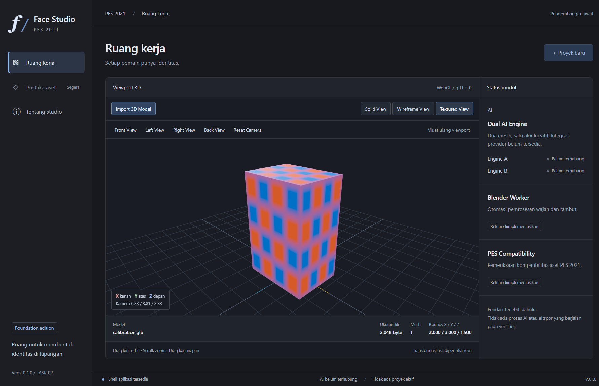

# TASK 02 — Viewport 3D nyata

Root: `D:\Projectku\Face-Builder`. TASK 02 selesai untuk cakupan viewport dan impor GLB mandiri. Tidak ada AI, sculpting, mesh editing, atau exporter PES yang dibuat.

## Fitur dan bukti

| Fitur                       | Implementasi dan verifikasi                                                                                                                      |
| --------------------------- | ------------------------------------------------------------------------------------------------------------------------------------------------ |
| Render 3D                   | React Three Fiber Canvas dengan WebGL2; terverifikasi di Edge dan Tauri/WebView2                                                                 |
| Orbit / zoom / pan          | OrbitControls: drag kiri, scroll, drag kanan. Test membaca perubahan posisi, target, dan jarak kamera yang sebenarnya                            |
| Lighting / grid / orientasi | Hemisphere + dua directional light, grid sesuai bounds model, axes helper, label arah XYZ, dan posisi kamera langsung                            |
| Impor lokal                 | File picker HTML memilih `.glb`; File API membaca ArrayBuffer, tanpa IPC filesystem Tauri                                                        |
| Auto-framing                | Bounding sphere dunia dipasang pada FOV tersempit (horizontal/vertikal); transformasi node tidak diubah                                          |
| Preset kamera               | Front dari +Z, Left dari -X, Right dari +X, Back dari -Z; Reset diagonal. Keempat arah dan reset diuji                                           |
| Solid                       | Material studio netral tanpa tekstur; mesh tetap memakai geometri, skin, dan transformasi asli                                                   |
| Wireframe                   | Material wireframe nyata, memperlihatkan triangulasi                                                                                             |
| Textured                    | Material asli GLTFLoader dipulihkan, termasuk texture map dan material groups                                                                    |
| Informasi model             | Nama file, ukuran byte, jumlah mesh, dan bounds X/Y/Z                                                                                            |
| Error                       | Envelope GLB, referensi eksternal, kompresi tertentu, bounds invalid, dan tekstur gagal ditangani; model sebelumnya tetap ada ketika impor gagal |
| Lifecycle                   | Geometry, material asli/varian, texture, bitmap, skeleton, dan blob URL dibersihkan; callback impor yang kedaluwarsa tidak mengganti model aktif |
| Pemulihan WebGL             | Context loss menghasilkan pesan dan tombol reload; pemulihan dengan model yang sama diuji                                                        |

Kamera saja yang dipindahkan untuk framing. Material asli tidak ditulis ulang ketika berganti mode. Model tidak di-center, tidak di-rescale, dan tidak diekspor.

## Sampel yang benar-benar digunakan

Generator Python standard library pada `tests/fixtures/generate.py` menghasilkan geometri kotak dan checker PNG embedded tanpa aset eksternal. Generator dan fixture diberi CC0-1.0 di README fixture.

- `calibration.glb`, 2.048 byte: translasi (2, 1, -1), skala (1, 1.5, 0.75), bounds dunia (2, 3, 1.5), satu mesh bertekstur.
- `large-transformed.glb`: posisi (200, 100, -50), skala (10, 30, 20), bounds (20, 60, 40). Penggantian model mengubah framing secara benar.
- `external-resource.glb`: fixture negatif dengan URL eksternal; ditolak dan tidak ada request ke domain tersebut.
- `broken-texture.glb`: PNG rusak; impor ditolak dan model sebelumnya dipertahankan.

Keberhasilan impor dibuktikan menggunakan sampel GLB tersebut, bukan hanya file picker atau status tombol. Sampel ini bukan wajah/rambut pemain; kompatibilitas aset PES maupun model produksi belum diuji.

## Hasil pemeriksaan akhir

| Pemeriksaan                   | Hasil                                                                                                                                 |
| ----------------------------- | ------------------------------------------------------------------------------------------------------------------------------------- |
| `npm run typecheck`           | Lulus; UI, config, test, dan modul core                                                                                               |
| `npm run build`               | Lulus; 39 modul, JS 1.220,99 kB / gzip 333,47 kB                                                                                      |
| `npm test`                    | 8 test lulus, 0 gagal; mencakup regresi shell TASK 01                                                                                 |
| `npm run desktop:dev`         | Lulus; compile incremental 56,36 detik, executable development berjalan                                                               |
| `node tests/native-smoke.mjs` | Lulus di Tauri WebView2 157.0.4341.42; WebGL2 aktif, impor bertekstur, orbit, zoom, Left/Reset, tiga mode render; 0 page error        |
| Perbandingan gambar           | Screenshot canvas Solid, Wireframe, dan Textured berbeda satu sama lain pada kamera tetap; ditinjau secara visual                     |
| Pembersihan resource          | Unit test memverifikasi disposal geometry/material/texture tepat sekali dan pemulihan material asli; penggantian model diuji lewat UI |

Log final: `task-02-typecheck.log`, `task-02-build.log`, `task-02-tests.log`. Bukti native terstruktur: `task-02-native.json`. Tidak ada dependency tambahan yang dipasang untuk TASK 02.

Build release/installer tidak dibangun ulang pada tugas ini. Executable release yang tersisa dari TASK 01 belum memuat fitur TASK 02; gunakan `npm run desktop:dev` untuk versi yang diverifikasi, atau jalankan `npm run desktop:build` untuk membangun release baru sendiri. Pengujian native memakai build development, bukan klaim pengujian installer.

## Perubahan file

Baru:

- `src/features/viewport/Viewport.tsx`: file picker, state, error boundary, toolbar, metadata.
- `src/features/viewport/Scene.tsx`: scene R3F, OrbitControls, lighting/grid, telemetri kamera, context loss.
- `src/features/viewport/model.ts`: GLB validation/loader, material modes, ownership dan disposal resource.
- `src/features/viewport/camera.ts`: framing dan arah kamera.
- `src/features/viewport/viewport.css`: gaya viewport mengikuti Dark Studio.
- `tests/viewport.spec.ts`, `tests/viewport-core.spec.ts`, `tests/native-smoke.mjs` dan fixture/generator.
- Laporan, log, JSON verifikasi, dan screenshot TASK 02 di `docs/`.

Dimodifikasi:

- `src/features/studio/Studio.tsx`: mengganti ilustrasi statis dengan viewport.
- `src/app/App.tsx`: status TASK 02 dan penjelasan fitur.
- `src-tauri/tauri.conf.json`: CSP mengizinkan blob/data lokal untuk pemuatan tekstur embedded. Tidak ada filesystem permission baru.
- `tsconfig.json`, `tsconfig.node.json`: pemeriksaan UI/config/test tanpa project-reference yang tumpang tindih.
- `tests/studio.spec.ts`: regresi shell sesuai empty state baru.
- `README.md`, `docs/architecture.md`, README viewport: cara pakai dan batas implementasi.

Laporan TASK 01 tetap tersedia. File game dan instalasi Blender tidak disentuh.

## Kendala yang ditemukan dan diselesaikan

1. Typecheck awal gagal TS6307, lalu TS6305 karena test core mengimpor sumber dari project reference composite yang tumpang tindih. Konfigurasi pemeriksaan dipisah tanpa emit/reference overlap; pemeriksaan akhir lulus.
2. Dua assertion awal salah: BoxGeometry default memiliki sisi 1, dan target kamera dibandingkan sebagai string float eksak. Fixture unit disamakan menjadi sisi 2; target pengganti dibandingkan dengan toleransi numerik. Seluruh test berikutnya lulus.
3. GLTFLoader dapat mengembalikan material tanpa map jika gambar gagal dibaca. LoadingManager sekarang mendeteksi kegagalan resource dan menolak impor parsial tersebut; fixture tekstur rusak membuktikannya.
4. Inspeksi native menemukan mojibake pada ikon navigasi akibat encoding saat edit. File dibaca/ditulis sebagai UTF-8 secara eksplisit, ikon diperbaiki, screenshot dan verifikasi akhir diulang.

Peringatan yang masih ada, bukan kegagalan:

- Vite memperingatkan ukuran chunk di atas 500 kB karena Three.js/R3F kini benar-benar digunakan. Optimisasi pemisahan bundle belum dilakukan; angka build dicatat apa adanya.
- R3F/dependency masih memakai `THREE.Clock` yang diberi peringatan deprecated oleh Three.js. Aplikasi tidak memakai Clock langsung dan tidak menambal dependency.
- Test negatif tekstur sengaja memunculkan error loader; error ini ditangani sebagai kegagalan impor yang terlihat. Test context-loss dapat memunculkan warning pelepasan context yang sudah hilang.

## Batas teknis

- GLB mandiri v2, maksimum 64 MiB. Ini batas file, bukan jaminan batas RAM/GPU setelah decoding.
- Draco, Meshopt, KTX2, dan URI eksternal ditolak. Tidak ada decoder yang diunduh diam-diam.
- Fokus verifikasi pada mesh segitiga statis. Animasi tidak dimainkan; skin/morph tidak diedit. Belum ada jaminan untuk setiap extension glTF, material kompleks, atau model produksi besar.
- Bounds sangat kecil/besar atau koordinat tidak finite ditolak. Satuan mengikuti model, bukan diasumsikan meter/PES units.
- Resize memulihkan framing dari preset terakhir. Orbit tidak memakai inertia/damping; demand rendering berhenti ketika input berhenti.
- Berpindah dari Ruang kerja atau menutup aplikasi melepas model. Belum ada persistensi proyek atau undo.
- Belum ada bukti kompatibilitas FMDL/PES, AI reconstruction, hair processing, atau exporter.

## Screenshot native



[Solid](images/task02-native-solid.png) · [Wireframe](images/task02-native-wireframe.png) · [Textured](images/task02-native-textured.png)

## Menjalankan dan mengulang verifikasi

```powershell
cd D:\Projectku\Face-Builder
npm run desktop:dev
```

Klik Import 3D Model dan pilih `tests/fixtures/calibration.glb`. Gunakan drag kiri/scroll/drag kanan dan tombol sudut/mode.

Untuk test browser: `npm run typecheck`, `npm run build`, lalu `npm test`. Untuk test native opsional, tutup instance development lain, jalankan di terminal pertama:

```powershell
$env:WEBVIEW2_ADDITIONAL_BROWSER_ARGUMENTS='--remote-debugging-port=9223'
npm run desktop:dev
```

Di terminal kedua, jalankan `node tests/native-smoke.mjs` setelah jendela terbuka. Port debugging dipakai hanya pada sesi verifikasi lokal; hentikan sesi development dengan Ctrl+C setelah selesai. Tidak ada perubahan registry atau konfigurasi debugging permanen.

## Rekomendasi TASK 03 (belum dikerjakan)

Sepakati format proyek dan persistensi model, lalu uji satu aset wajah/rambut nyata dengan lisensi yang jelas untuk menetapkan konvensi skala, arah, nama mesh, dan material. Setelah itu tentukan cakupan editor berikutnya. Optimisasi bundle dan anggaran GPU dapat diprioritaskan sebelum memasukkan model besar. Tidak ada TASK 03 yang dimulai.

## Referensi implementasi

- [R3F Canvas dan demand rendering](https://r3f.docs.pmnd.rs/api/canvas)
- [Three.js GLTFLoader](https://threejs.org/docs/#GLTFLoader)
- [Playwright untuk WebView2 melalui CDP](https://playwright.dev/docs/webview2)

Perilaku resource loader dan API kontrol juga diperiksa pada source dependency Three.js yang terpasang. Hasil lokal dibuktikan oleh test dan log di atas, bukan diasumsikan hanya dari dokumentasi.
